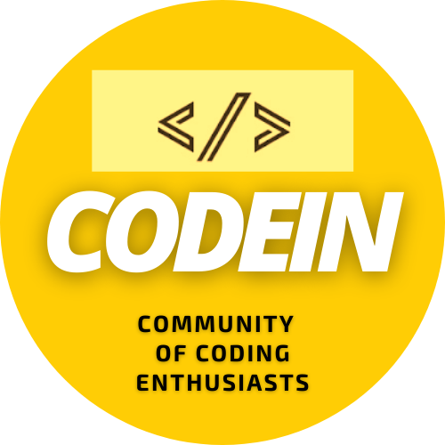
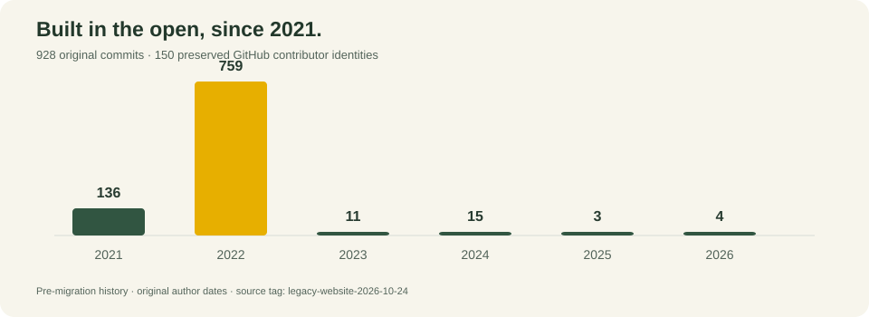
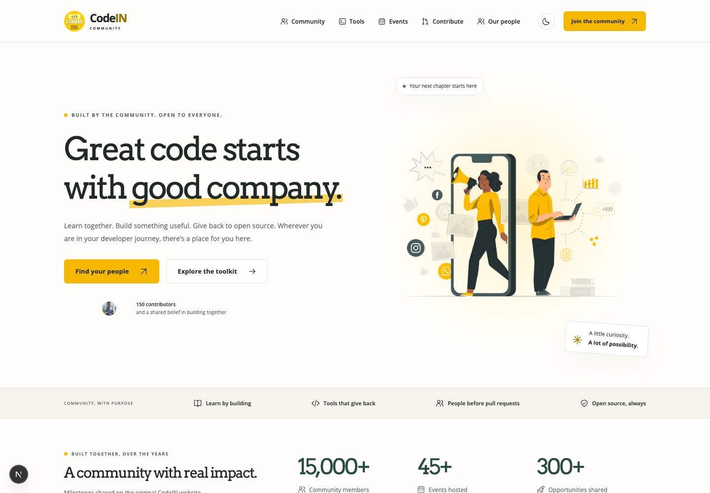
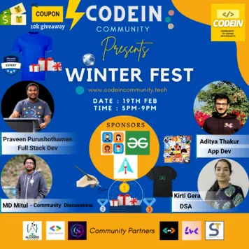
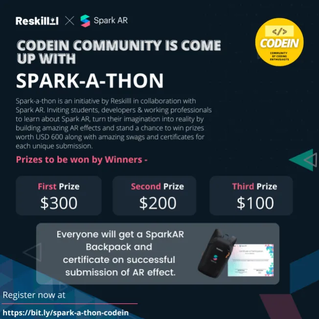
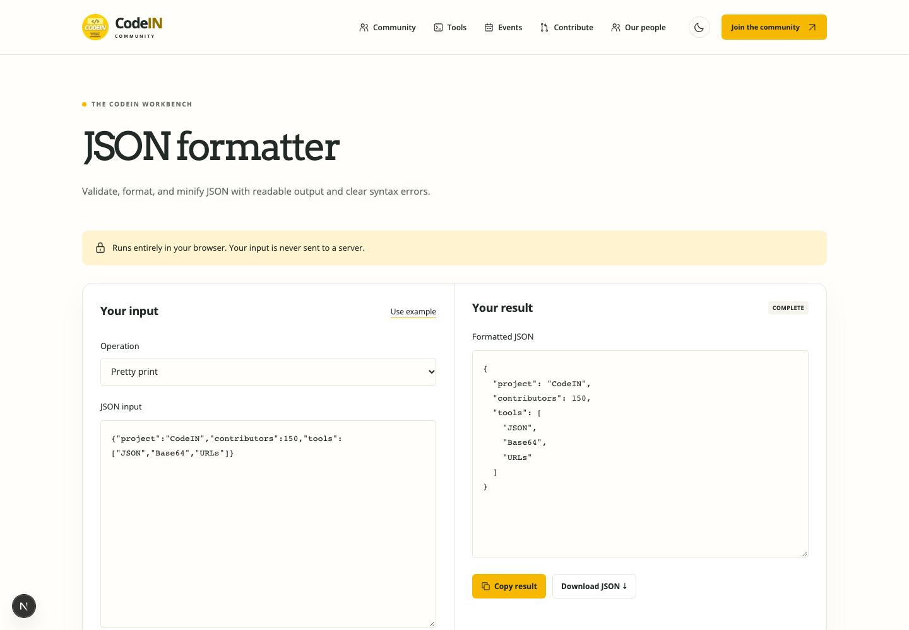
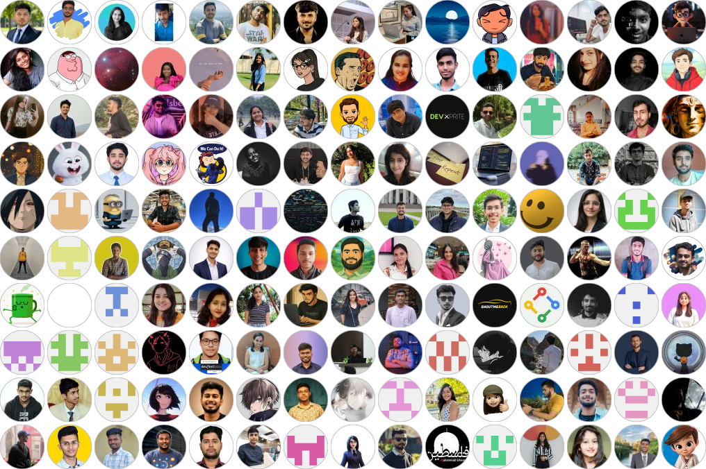
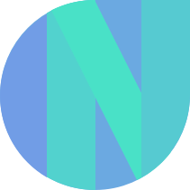

<p align="center">
  
</p>

<h1 align="center">CodeIN Community</h1>

<p align="center"><strong>Learn together. Build useful things. Give back to open source.</strong></p>
<p align="center">A developer community built in the open since September 2021 — now with a modern website and a practical developer toolkit.</p>

<p align="center">
  <a href="https://codeincommunity.com">Website</a> ·
  <a href="https://codeincommunity.com/tools">Developer tools</a> ·
  <a href="https://codeincommunity.com/contribute">Start contributing</a> ·
  <a href="https://codeincommunity.com/events">Events</a> ·
  <a href="https://codeincommunity.com/docs">Documentation</a>
</p>

<p align="center">
  <a href="https://github.com/SauravMukherjee44/CodeIN-Community/actions/workflows/ci.yml"></a>
  <a href="https://github.com/SauravMukherjee44/CodeIN-Community/stargazers"></a>
  <a href="https://github.com/SauravMukherjee44/CodeIN-Community/network/members"></a>
  <a href="LICENSE"></a>
  <a href="https://github.com/SauravMukherjee44/CodeIN-Community/commits/main/"></a>
</p>

## Building together since 2021

**928 original commits · 150 credited contributors · Original authors and dates preserved**

| September 2021                                                                                                                    | January 31, 2022                                                                                                               | Original website                                                                                                               |
| --------------------------------------------------------------------------------------------------------------------------------- | ------------------------------------------------------------------------------------------------------------------------------ | ------------------------------------------------------------------------------------------------------------------------------ |
| [View our founding commit](https://github.com/SauravMukherjee44/CodeIN-Community/commit/8600a7c8943d7a36e9fba696953ecd8aeacb34b2) | [View community PR #87](https://github.com/SauravMukherjee44/CodeIN-Community/commit/55f5bb3976d1c32a4b02475164cedef375eef6e3) | [Browse the source before modernization](https://github.com/SauravMukherjee44/CodeIN-Community/tree/legacy-website-2026-10-24) |

[](https://github.com/SauravMukherjee44/CodeIN-Community/commits/legacy-website-2026-10-24/)

This is the original repository, continuing under a new name. GitHub’s file list shows each path’s latest change, including the recent migration; the older commits remain in its ancestry. [Meet our contributors](https://codeincommunity.com/contributors) · [Explore our heritage](https://codeincommunity.com/heritage) · [Original commit history](https://github.com/SauravMukherjee44/CodeIN-Community/commits/legacy-website-2026-10-24/)

## A community with real impact

| Community members | Events hosted | Opportunities shared | GitHub contributors credited |
| :---------------: | :-----------: | :------------------: | :--------------------------: |
|    **15,000+**    |    **45+**    |       **300+**       |           **150**            |

Community milestones carry forward the figures published on the [original CodeIN website](legacy/website/index.html#L1950). The contributor count is our preserved GitHub baseline, with complete pagination and stable identities.

[](https://codeincommunity.com)

## Community programs

The original program banners remain on the landing page, with their stories and recordings. These are past community programs.

|          [100 Days of Code](https://codeincommunity.com/events/100-days-of-code)          |        [Winter Fest 2022](https://codeincommunity.com/events/winter-fest)        |          [Spark-a-thon](https://codeincommunity.com/events/spark-a-thon)           |
| :---------------------------------------------------------------------------------------: | :------------------------------------------------------------------------------: | :--------------------------------------------------------------------------------: |
|  |  |  |

## Tools for everyday development

All three developer utilities run locally in the browser. No accounts, uploads, or installation are required.

| Tool                                                                     | What it does                                                                                                |
| ------------------------------------------------------------------------ | ----------------------------------------------------------------------------------------------------------- |
| [JSON formatter](https://codeincommunity.com/tools/json-formatter)       | Validate, pretty print, and minify JSON while preserving numeric literals, key order, and escape sequences. |
| [Base64 converter](https://codeincommunity.com/tools/base64)             | Encode and decode UTF-8 text, including emoji and multilingual content.                                     |
| [URL & query inspector](https://codeincommunity.com/tools/url-inspector) | Inspect URL components and repeated query keys, or encode and decode a component without visiting the URL.  |

[](https://codeincommunity.com/tools)

Have an idea for another utility? [Submit your own tool](https://github.com/SauravMukherjee44/CodeIN-Community/issues/new?template=tool.yml). Describe the requirements in the guided GitHub form, publish the issue, and coordinate implementation with maintainers. GitHub sign-in is required; proposals are public.

## Tools for open-source maintainers

| Tool                                                                                      | What it does                                                                                                              |
| ----------------------------------------------------------------------------------------- | ------------------------------------------------------------------------------------------------------------------------- |
| [Repository Readiness Auditor](https://codeincommunity.com/tools/repository-audit)        | Evidence-backed checks for contributor-facing documentation, policies, templates, tests, and CI. Export Markdown or JSON. |
| [Contribution Template Builder](https://codeincommunity.com/tools/contribution-templates) | Generate contribution guidance, a PR template, and bug/feature issue forms. Preview files and download a ZIP.             |
| [Contributor Credits Generator](https://codeincommunity.com/tools/contributor-credits)    | Fetch paginated public GitHub contributors and export Markdown or structured JSON with sorting and bot controls.          |

The maintainer workflows share tested TypeScript engines with the CLI. The website accepts public GitHub repositories; the auditor CLI also accepts local directories. Presence checks are guidance rather than certification of code quality, legal sufficiency, or security.

## Built by our contributors

Every contribution is part of this project’s story. All **150 baseline GitHub contributor identities** remain credited through the modernization.

[](https://codeincommunity.com/contributors)

[Search all contributors](https://codeincommunity.com/contributors) · [Complete contributor record](docs/CONTRIBUTORS.md) · [Live GitHub contributor graph](https://github.com/SauravMukherjee44/CodeIN-Community/graphs/contributors)

## Our history continues here

This is the **same repository**, founded in September 2021, previously named `CodeIN-Community-Website`. The modern website and toolkit build on the existing Git history; original commit authors and dates remain intact.

[](https://github.com/SauravMukherjee44/CodeIN-Community/commits/main/)

The pre-migration history contains **928 commits**, including 2021–2026 contributions. The chart records original author dates at the preservation tag; its [source data](docs/repository-history.json) is checked into this repository.

[Browse the full commit history](https://github.com/SauravMukherjee44/CodeIN-Community/commits/main/) · [Explore commits before 2026](https://github.com/SauravMukherjee44/CodeIN-Community/commits/main/?until=2025-12-31) · [Community heritage](https://codeincommunity.com/heritage)

All **406 original tracked files**, assets, documentation, and third-party notices are preserved under [`legacy/website`](legacy/website). Their SHA-256 hashes are recorded in [`legacy/manifest.json`](legacy/manifest.json), and the original source is tagged [`legacy-website-2026-10-24`](https://github.com/SauravMukherjee44/CodeIN-Community/tree/legacy-website-2026-10-24). Legacy scripts and dependencies are excluded from the modern build. Historical volunteer roles remain separate from current maintainer roles.

```sh
node scripts/verify-legacy.mjs
node scripts/generate-readme-history.mjs
```

## Sponsors and community partners

With gratitude to the organizations recognized on the original community website. Their logos remain visible on the modern homepage.

<p align="center">
  <a href="https://www.geeksforgeeks.org/"></a>&nbsp;&nbsp;
  <a href="https://www.azdev.community/"></a>&nbsp;&nbsp;
  <a href="https://givemycertificate.com/"></a>&nbsp;&nbsp;
  <a href="https://www.newtonschool.co/"></a>&nbsp;&nbsp;
  <a href="https://www.codingminutes.com/"></a>
</p>

<p align="center"><strong>Community partner</strong><br /><br />
  <a href="https://www.netlify.com"></a>
</p>

Netlify hosts the community website at [codeincommunity.com](https://codeincommunity.com).

## Run locally

Use **Node.js 24**, **pnpm 11.25.0**, Next.js 16, React 19, strict TypeScript, and Tailwind CSS.

```sh
corepack enable
corepack prepare pnpm@11.25.0 --activate
pnpm install --frozen-lockfile
pnpm dev
```

Open `http://127.0.0.1:3100`. No token is required. An optional server-only `CODEIN_GITHUB_TOKEN` improves public GitHub rate limits; never prefix it with `NEXT_PUBLIC_`. The CLI reads `GITHUB_TOKEN` separately. Private repositories are not supported.

| Workspace          | Purpose                                                                                |
| ------------------ | -------------------------------------------------------------------------------------- |
| `apps/web`         | Community website, MDX documentation, and browser tools                                |
| `packages/toolkit` | Portable ESM engines, GitHub adapter, developer utilities, and TypeScript declarations |
| `packages/cli`     | Bundled `codein` command-line interface                                                |
| `legacy/website`   | Preserved original website and third-party notices                                     |

## CLI and TypeScript library

Download verified `.tgz` archives and `checksums.txt` from [GitHub Releases](https://github.com/SauravMukherjee44/CodeIN-Community/releases). npm publication is deferred.

```sh
npm install -g ./codein-community-cli-0.1.1.tgz
codein audit ./my-project --format json
codein templates --repo owner/repo --out ./contribution-kit
codein credits owner/repo --format markdown --exclude-bots
```

Audit exits: **0** all checks present, **1** missing/unknown findings, **2** execution or input error. Credits exits **1** for partial results. Templates refuse to overwrite existing files without `--overwrite`.

```ts
import { auditRepository } from "@codein-community/toolkit";
import { fetchRepository } from "@codein-community/toolkit/github";
import {
  formatJson,
  convertBase64,
  inspectUrl,
} from "@codein-community/toolkit/developer";

const report = auditRepository(await fetchRepository("owner/repo"));
const formatted = formatJson('{"hello":"CodeIN"}');
```

[CLI reference](packages/cli/README.md) · [Library interfaces](packages/toolkit/README.md) · [Online documentation](https://codeincommunity.com/docs)

## Verify changes

```sh
pnpm typecheck
pnpm lint
pnpm test
pnpm build
pnpm exec playwright install chromium
pnpm test:e2e
pnpm pack:release
node scripts/smoke-package.mjs
```

Browser coverage includes all six tool workflows, validation and downloads, layout bounds from 320px to 1920px, complete event posters, sponsor logos, theme switching, keyboard navigation, URL compatibility, contributor fallback, and automated accessibility. Run against a deployed preview with `PLAYWRIGHT_BASE_URL=https://your-preview.netlify.app pnpm test:e2e`.

## Join in

Read [CONTRIBUTING.md](CONTRIBUTING.md), [CODE_OF_CONDUCT.md](CODE_OF_CONDUCT.md), and [SECURITY.md](SECURITY.md). Start with [a guided contribution track](https://codeincommunity.com/contribute), or discuss a focused improvement in [GitHub issues](https://github.com/SauravMukherjee44/CodeIN-Community/issues).

[Discord](https://discord.com/invite/sqFRzrj7f3) · [Telegram](https://t.me/CodeINCommunity) · [LinkedIn](https://www.linkedin.com/company/codein-community/) · [Email](mailto:codeincommunity@gmail.com)

Maintained by [Saurav Mukherjee](https://github.com/SauravMukherjee44). Deployment and rollback procedures are documented in [docs/DEPLOYMENT.md](docs/DEPLOYMENT.md). MIT licensed; original third-party notices remain in the archive.
